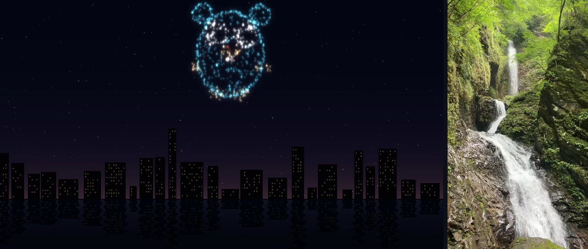

# hwmediacodec

[English](README.md) | [日本語](README.ja.md)



Go から GPU のハードウェアで動画（H.264、HEVC、AV1）をデコード・エンコードする
ライブラリです。**cgo は不要**で、OS が持つ音声コーデック（AAC、Opus）も同じ API
で扱えます。macOS、iOS、Android、Linux、Windows、ブラウザを 1 つのモジュールで
サポートします。各プラットフォームのコーデックエンジン（VideoToolbox、MediaCodec、
VA-API、Intel VPL、NVDEC/NVENC、Media Foundation、WebCodecs）を実行時に読み込む
ため、`CGO_ENABLED=0 go build` でビルドでき、1 台のマシンから全ターゲットへ
クロスコンパイルできます。

<sub>上の画像もこのライブラリで作っています。花火は Ebitengine のゲーム画面を
`capture` で録画したもので、両方のフレームは AMD Radeon 890M 上で
`examples/thumbnails` を使って切り出しました。</sub>

## できること

- 🎮 **ゲームでの動画再生**: MP4 や WebM を音声付きで Ebitengine のゲーム内で
  再生できます。デコードは GPU が行い、シークやループにも対応しています。
  デスクトップ、スマートフォン、ブラウザのどれでも動きます。
- 📡 **ゲーム画面をブラウザへ配信**: ゲームが描画した画面をエンコードして、
  WebRTC（遅延 100 ms 程度）や HLS でブラウザに配信できます。MP4 への録画も
  できます。
- 🛠️ **CLI ツールでのフォーマット変換**: H.264 ↔ HEVC（↔ AV1）の変換、
  サムネイル抽出、HEIC/AVIF ↔ PNG/JPEG の変換を、ffmpeg を同梱せずに
  ハードウェアコーデックで行えます。

## 対応状況

✅ 実機で確認済み · ⚠️ 実装済み・未確認 · （空欄）非対応

**動画**

| プラットフォーム | バックエンド | 確認した機種 | H.264 デコード | H.264 エンコード | HEVC デコード | HEVC エンコード | AV1 デコード | AV1 エンコード |
| --- | --- | --- | :-: | :-: | :-: | :-: | :-: | :-: |
| [macOS](REPORT_MACOS.md)（Apple Silicon） | VideoToolbox | M3 | ✅ | ✅ | ✅ | ✅ | ✅ | |
| [iOS](REPORT_IOS.md) 15 以降 | VideoToolbox | iPhone SE 第 3 世代（[#31](https://github.com/shibukawa/hwmediacodec/issues/31)） | ✅ | ✅ | ✅ | ✅ | ⚠️ | |
| [Android](REPORT_ANDROID.md) 14 以降 | MediaCodec | Redmi Pad SE | ✅ | ✅ | ✅ | ✅ | ⚠️ | |
| [Linux](REPORT_LINUX.md)、AMD | VA-API | Radeon 890M（[#38](https://github.com/shibukawa/hwmediacodec/issues/38)、[#39](https://github.com/shibukawa/hwmediacodec/issues/39)） | ✅ | ✅ | ✅ | ✅ | ✅ | ✅ |
| [Linux](REPORT_LINUX.md)、Intel | Intel VPL / VA-API | | ⚠️ | ⚠️ | ⚠️ | ⚠️ | ⚠️ | ⚠️ |
| [Linux](REPORT_LINUX.md)、NVIDIA | NVDEC / NVENC | | ⚠️ | ⚠️ | ⚠️ | ⚠️ | ⚠️ | |
| [Windows](REPORT_WINDOWS.md)、NVIDIA | NVDEC / NVENC | RTX 2060 Max-Q（[#33](https://github.com/shibukawa/hwmediacodec/issues/33)、[#35](https://github.com/shibukawa/hwmediacodec/issues/35)） | ✅ | ✅ | ✅ | ✅ | ⚠️ | |
| [Windows](REPORT_WINDOWS.md)、Intel | Media Foundation | Intel 内蔵 GPU | ✅ | ✅ | ✅ | ⚠️ | ✅ | |
| [Windows](REPORT_WINDOWS.md)、AMD | Media Foundation | Ryzen 4000 内蔵 GPU（[#35](https://github.com/shibukawa/hwmediacodec/issues/35)） | ✅ | ✅ | ✅ | ✅ | ⚠️ | |
| [Windows](REPORT_WINDOWS.md)、ARM64 | Media Foundation | | ⚠️ | ⚠️ | ⚠️ | ⚠️ | ⚠️ | |
| [ブラウザ](REPORT_BROWSER.md): Chrome、Safari | WebCodecs | macOS（M3） | ✅ | ✅ | ✅ | ✅ | ✅ | |
| [ブラウザ](REPORT_BROWSER.md): Firefox | WebCodecs | macOS（M3） | ✅ | ✅ | | | ⚠️ | |
| [ブラウザ](REPORT_BROWSER.md): その他の OS | WebCodecs | | ⚠️ | ⚠️ | ⚠️ | ⚠️ | ⚠️ | |

AV1 のデコードには AV1 デコーダを持つ GPU（Apple M3、Radeon RX 6000、Intel
Tiger Lake、GeForce RTX 30 以降）が必要です。AV1 のエンコードは今のところ
VA-API だけが対応しています。Apple Silicon には AV1 エンコーダがありません。

**音声**（OS のソフトウェアコーデック）

| プラットフォーム | バックエンド | AAC デコード | AAC エンコード | Opus デコード | Opus エンコード |
| --- | --- | :-: | :-: | :-: | :-: |
| [macOS](REPORT_MACOS.md)、[iOS](REPORT_IOS.md) | AudioToolbox | ✅ | ✅ | ✅ | ✅ |
| [Android](REPORT_ANDROID.md) | MediaCodec | ✅ | ✅ | ✅ | ✅ |
| [Linux](REPORT_LINUX.md) | libavcodec、libfdk-aac、libopus（インストールされていれば） | ✅ | ✅ | ✅ | ✅ |
| [Windows](REPORT_WINDOWS.md) | Media Foundation | ✅ | ✅ | ⚠️ | |
| [ブラウザ](REPORT_BROWSER.md)（macOS） | WebCodecs | ✅ | ✅（Firefox 以外） | ✅ | ✅ |

Linux で AAC を使うには libavcodec か libfdk-aac が必要です。Ubuntu では
`sudo apt install ubuntu-restricted-extras` で両方入ります。機種、ドライバ、
計測値、各バックエンドのクセなどの詳細は、表からリンクしているプラットフォーム別の
レポート（英語）にまとめています。これまでに送られたチェック結果は
[「Check report」という題の issue](https://github.com/shibukawa/hwmediacodec/issues?q=is%3Aissue+%22Check+report%22)
で見られます。

### お使いのマシンでのチェック

次のコマンドを実行すると、お使いのマシンでこのライブラリが何をできるかを確認
できます。⚠️ の欄を埋めるのにご協力ください。

```sh
go run github.com/shibukawa/hwmediacodec/cmd/hwmediacodec@latest check
```

同梱の動画を H.264、HEVC、AV1 でデコードし、マシンが対応するすべてのコーデック
でエンコードしてデコードし直し、動画を音声付きで再生し、H.264 と HEVC を WebRTC
でブラウザに配信します。最後にレポートを出力し、その内容を記入済みの
[新しい issue](https://github.com/shibukawa/hwmediacodec/issues/new) を開く
リンクを表示しますので、ぜひ送ってください。`-auto` を付けるとウィンドウを
開かずに自動チェックだけを行います。詳しくは
[コマンドの README](cmd/hwmediacodec/README.md#check) を参照してください。

## ユースケース別の実装メモ

### 🎮 ゲームでの動画再生

[`ebitenvideo`](ebitenvideo) モジュールは動画を `*ebiten.Image` に再生し、
音声を Ebitengine の audio で鳴らします。

```go
d, _ := mp4.Open("movie.mp4")                     // AV1 + Opus なら webm.Open
player, err := ebitenvideo.NewPlayerFromSource(d.Video().PacketSource(),
	ebitenvideo.WithAudio(d.Audio().PacketSource()), ebitenvideo.WithLoop())
player.Play()

func (g *game) Update() error { return player.Update() }
func (g *game) Draw(screen *ebiten.Image) {
	if img := player.Image(); img != nil {
		screen.DrawImage(img, nil)
	}
}
```

- デコードはバックグラウンドの goroutine で数フレーム先まで、表示順に RGBA で
  行います。間に合わなかったフレームはスキップします。`Seek`、`Pause`、
  `SetVolume`、ループ再生に対応しています。
- 音声が時計になり、映像はオーディオデバイスの再生位置に合わせて進みます。
  音が出せない場合（最初のクリック前のブラウザや、AAC デコーダのない環境）でも、
  映像はゲームの時計で再生され続けます。
- **ブラウザ**: 同じコードが `GOOS=js GOARCH=wasm` でビルドでき、WebCodecs で
  デコードします。Firefox の WebCodecs は HEVC に対応していないので、H.264 版も
  用意しておいてください。
- **モバイル**: `ebitenmobile bind` で iOS と Android 向けにビルドできます
  （purego が必要とするため、モバイルでは `CGO_ENABLED=1` になります。
  ライブラリ自体は cgo のコードを含みません）。
- Ebitengine 以外のエンジンや自前の描画系では、
  [`playback`](GUIDE.md#playback) パッケージが使えます。Ebitengine に依存しない
  同じプレイヤーで、呼び出し側が進める時計に合わせて RGBA（または NV12）の
  フレームを返します。
- 試すには `go run github.com/shibukawa/hwmediacodec/examples/player@latest`
  を実行します（引数なしで同梱の動画、MP4 / WebM を渡すとそのファイルを
  再生します）。`examples/texture` は動画を箱に貼ったり Kage シェーダーに
  通したりするサンプルです。

### 📡 ゲーム画面をブラウザへ配信

[`capture`](GUIDE.md#screen-recording) は、ゲームが描画した画面を毎フレーム
読み取り、バックグラウンドの goroutine でエンコードします。パケットの出力先は
自由に選べ、たとえば [`net/webrtc`](net/webrtc) モジュールの WebRTC 配信に
渡せます。

```go
var rec *capture.Recorder
bc := webrtc.NewBroadcaster(60, nil, func() { rec.RequestKeyframe() })
rec, _ = capture.New(1280, 720, bc, capture.Options{
	FPS: 60, LowLatency: true, Profile: hwmediacodec.ProfileBaseline})
http.Handle("/offer", bc)        // ページが SDP offer をここに POST する

func (g *game) Draw(screen *ebiten.Image) {
	g.scene.Draw(screen)
	rec.Capture(screen)          // エンコーダを待ってブロックすることはない
}
```

- **WebRTC**（`net/webrtc`、pion）: エンドツーエンドで 100 ms 程度です。
  シグナリングは HTTP POST 1 回です。H.264 はどこでも使えます。HEVC は
  `NewCodecBroadcaster` で、ブラウザがデコードできる環境で使えます（Safari、
  macOS と Windows でハードウェアデコーダのある Chrome。Edge は有料の HEVC
  拡張機能がないと再生できません。Linux の Chrome は未確認です）。
- **HLS**（`mp4.Segmenter` + `net/hls`）: 遅延は数秒です。Safari はそのまま
  再生でき、他のブラウザでは hls.js などを使います。
- **録画**: 出力先に `mp4.CreateVideoFile` を渡すと MP4 ファイルに保存します。
- `capture` は Ebitengine をインポートしていないので、`ReadPixels` を持つものなら
  何でも録画できます。配信のエンドポイントには認証がないため、信頼できる
  インターフェースで公開するか、アプリケーション側の認証の後ろに置いてください。
- 試すには `go run github.com/shibukawa/hwmediacodec/examples/webrtc@latest`
  （または `hls`、`record`）を実行します。花火のシーンを配信し、ブラウザを
  開きます。

### 🛠️ CLI ツールでのフォーマット変換

トランスコーダは、デマルチプレクサとマルチプレクサの間にデコーダとエンコーダを
並べたものです。

```go
d, _ := mp4.Open("input.mp4")
src := d.Video().PacketSource()
dec, _ := hwmediacodec.NewDecoder(ctx, src.Codec(), hwmediacodec.WithTimeScale(src.TimeScale()))
enc, _ := hwmediacodec.NewEncoder(ctx, hwmediacodec.HEVC, w, h,
	hwmediacodec.WithTimeScale(src.TimeScale()), hwmediacodec.WithBitrate(6_000_000))
out := hwmediacodec.NewEncodeWriter(enc, track) // track: mp4.Create("output.mp4") の動画トラック
_, err := hwmediacodec.CopyFrames(ctx, out, hwmediacodec.NewDecodeReader(dec, src))
err = out.Flush(ctx)
```

- コンテナ: MP4/MOV（`mediacontainer/mp4`、fMP4 セグメントも可）、AV1 + Opus の
  WebM（`mediacontainer/webm`）、IVF、ADTS（`.aac`）、生の Annex-B。
  画像: HEIC と AVIF を標準の `image` パッケージ経由で扱えます
  （`image/heif`、`image/avif`）。
- ライブラリが扱うのはフレームとサンプルまでです。拡大縮小、リサンプリング、
  フィルタはありません。フィルタは `FrameReader` や `FrameWriter` をラップして
  作ります。
- `errors.Is(err, hwmediacodec.ErrUnsupported)` で、そのマシンに処理できる
  エンジンがないことが分かります。`HasHardware` で事前に確認でき、
  `WithSoftwareFallback` を指定すると OS のソフトウェアコーデックがあれば
  それを使います。
- すぐ使えるツールを用意しています。どれも `go run …@latest` で実行できます。

  ```sh
  go run github.com/shibukawa/hwmediacodec/examples/convert@latest -codec hevc -bitrate 6M input.mp4 output.mp4
  go run github.com/shibukawa/hwmediacodec/examples/thumbnails@latest -every 10s -o thumbs movie.mp4
  go run github.com/shibukawa/hwmediacodec/examples/imgconv@latest photo.heic photo.png
  go run github.com/shibukawa/hwmediacodec/cmd/hwmediacodec@latest probe
  ```

  `convert` はタイムスタンプを保ったまま変換し、音声はそのままコピーします。
  `cmd/hwmediacodec` には生ストリーム向けの `decode`、`encode`、`transcode` と
  その音声版もあります（[ガイド](GUIDE.md#command-line-tool)を参照）。

## パッケージ

| インポートパス | 内容 |
| --- | --- |
| `github.com/shibukawa/hwmediacodec` | コーデック API: `Probe`、`NewDecoder`、`NewEncoder`、`NewAudioDecoder`、`NewAudioEncoder`、パケットとフレーム |
| `.../encoding/annexb` | H.264/HEVC の Annex-B バイトストリーム: NAL ユニットとアクセスユニットへの分割、NAL ユニットの種別判定 |
| `.../encoding/adts` | ADTS 形式の AAC（`.aac` ファイル）のリーダーとライター |
| `.../mediacontainer/mp4` | MP4/MOV のデマルチプレクサとマルチプレクサ（動画、AAC と Opus の音声）、fMP4 セグメンタ |
| `.../mediacontainer/webm` | AV1 動画と Opus 音声の WebM デマルチプレクサとマルチプレクサ |
| `.../mediacontainer/ivf` | IVF（AV1）のリーダーとライター |
| `.../image/heif` | HEIC 静止画（HEVC）。標準の `image` パッケージに登録されます |
| `.../image/avif` | AVIF 静止画（AV1）。標準の `image` パッケージに登録されます |
| `.../net/hls` | fMP4 セグメントを配信するライブ HLS のプレイリストと HTTP ハンドラ |
| `.../playback` | 時計に合わせたストリーム再生: バックグラウンドデコード、ペース調整、シーク、ループ |
| `.../capture` | 描画結果（Ebitengine の画面など）をエンコーダで録画して出力先へ送る |
| `.../net/webrtc` | 別モジュール: H.264 / HEVC のストリームを WebRTC（pion）でブラウザへ配信 |
| `.../ebitenvideo` | 別モジュール: フレームを `*ebiten.Image` に出す `playback` |
| `.../cmd/hwmediacodec` | 別モジュール: コマンドラインツールとマシンチェック |
| `.../examples` | 別モジュール: 完成したプログラム集（変換、サムネイル、録画、HLS と WebRTC のサーバー、プレイヤー、モバイルアプリ）。[examples/README.md](examples/README.md) を参照 |

コアモジュールの依存は purego、`golang.org/x/sys`、MP4 と画像のパッケージ用の
[mp4ff](https://github.com/Eyevinn/mp4ff) だけで、いずれも pure Go です。
Ebitengine と pion は別モジュールからのみ読み込まれます。Go 1.27 以降が
必要です。

## ドキュメント（英語）

- [GUIDE.md](GUIDE.md): API の詳細（コーデック API、ピクセルフォーマットと
  フレーム順、パイプライン、音声、MP4、WebM、HLS、WebRTC、録画、画像、再生、
  Ebitengine、CLI、環境変数）
- プラットフォーム別レポート: [macOS](REPORT_MACOS.md)、[iOS](REPORT_IOS.md)、
  [Android](REPORT_ANDROID.md)、[Linux](REPORT_LINUX.md)、
  [Windows](REPORT_WINDOWS.md)、[ブラウザ](REPORT_BROWSER.md)
- [CONTRIBUTING.md](CONTRIBUTING.md): 結果の報告、テスト、リリース手順
