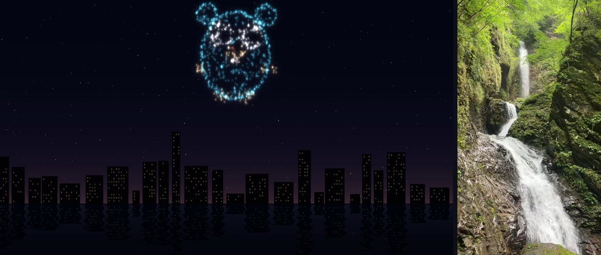

# hwmediacodec

[English](README.md) | [日本語](README.ja.md)



Hardware video decoding and encoding (H.264, HEVC, AV1) from Go, **without
cgo**, plus the operating system's audio codecs (AAC, Opus) through the
same API. One module for macOS, iOS, Android, Linux, Windows and the
browser: the library loads the platform's codec engine at run time
(VideoToolbox, MediaCodec, VA-API, Intel VPL, NVDEC/NVENC, Media
Foundation, WebCodecs), so `CGO_ENABLED=0 go build` works and everything
cross-compiles from one machine.

<sub>The picture above was made with the library itself: the fireworks
show was recorded from an Ebitengine game with `capture`, and both frames
were taken out with `examples/thumbnails` on an AMD Radeon 890M.</sub>

## What it is for

- 🎮 **Videos in games**: play an MP4 or WebM with sound inside an
  Ebitengine game, decoded by the GPU, with seeking and looping, on the
  desktop, on phones and in the browser. The frame is an ordinary
  `*ebiten.Image`, so a video also works as a texture: on a 3D object, on
  an in-game screen, or through a shader.
- 📡 **Streaming a game to the browser**: encode what the game draws and
  send it to browsers over WebRTC (about 100 ms of latency) or HLS, or
  record it to MP4.
- 🛠️ **Format conversion in CLI tools**: convert H.264 ↔ HEVC (↔ AV1),
  extract thumbnails, convert HEIC/AVIF ↔ PNG/JPEG, with the hardware codecs
  and without shipping ffmpeg.

## Status

✅ verified on real hardware · ⚠️ implemented, not verified yet · (blank) not available

**Video**

| Platform | Backend | Verified on | H.264 dec | H.264 enc | HEVC dec | HEVC enc | AV1 dec | AV1 enc |
| --- | --- | --- | :-: | :-: | :-: | :-: | :-: | :-: |
| [macOS](REPORT_MACOS.md) (Apple Silicon) | VideoToolbox | M3 | ✅ | ✅ | ✅ | ✅ | ✅ | |
| [iOS](REPORT_IOS.md) 15+ | VideoToolbox | iPhone SE 3 ([#31](https://github.com/shibukawa/hwmediacodec/issues/31)) | ✅ | ✅ | ✅ | ✅ | ⚠️ | |
| [Android](REPORT_ANDROID.md) 14+ | MediaCodec | Redmi Pad SE | ✅ | ✅ | ✅ | ✅ | ⚠️ | |
| [Linux](REPORT_LINUX.md), AMD | VA-API | Radeon 890M ([#38](https://github.com/shibukawa/hwmediacodec/issues/38), [#39](https://github.com/shibukawa/hwmediacodec/issues/39)) | ✅ | ✅ | ✅ | ✅ | ✅ | ✅ |
| [Linux](REPORT_LINUX.md), Intel | Intel VPL / VA-API | | ⚠️ | ⚠️ | ⚠️ | ⚠️ | ⚠️ | ⚠️ |
| [Linux](REPORT_LINUX.md), NVIDIA | NVDEC / NVENC | | ⚠️ | ⚠️ | ⚠️ | ⚠️ | ⚠️ | |
| [Windows](REPORT_WINDOWS.md), NVIDIA | NVDEC / NVENC | RTX 2060 Max-Q ([#33](https://github.com/shibukawa/hwmediacodec/issues/33), [#35](https://github.com/shibukawa/hwmediacodec/issues/35)) | ✅ | ✅ | ✅ | ✅ | ⚠️ | |
| [Windows](REPORT_WINDOWS.md), Intel | Media Foundation | Intel iGPU | ✅ | ✅ | ✅ | ⚠️ | ✅ | |
| [Windows](REPORT_WINDOWS.md), AMD | Media Foundation | Ryzen 4000 iGPU ([#35](https://github.com/shibukawa/hwmediacodec/issues/35)) | ✅ | ✅ | ✅ | ✅ | ⚠️ | |
| [Windows](REPORT_WINDOWS.md), ARM64 | Media Foundation | | ⚠️ | ⚠️ | ⚠️ | ⚠️ | ⚠️ | |
| [Browser](REPORT_BROWSER.md): Chrome, Safari | WebCodecs | macOS (M3) | ✅ | ✅ | ✅ | ✅ | ✅ | |
| [Browser](REPORT_BROWSER.md): Firefox | WebCodecs | macOS (M3) | ✅ | ✅ | | | ⚠️ | |
| [Browser](REPORT_BROWSER.md): other OSes | WebCodecs | | ⚠️ | ⚠️ | ⚠️ | ⚠️ | ⚠️ | |

AV1 decoding needs a GPU with an AV1 decoder (Apple M3, Radeon RX 6000,
Intel Tiger Lake, GeForce RTX 30 and newer). AV1 encoding is wired up on
VA-API only; Apple Silicon has no AV1 encoder.

**Audio** (the OS's software codecs)

| Platform | Backend | AAC dec | AAC enc | Opus dec | Opus enc |
| --- | --- | :-: | :-: | :-: | :-: |
| [macOS](REPORT_MACOS.md), [iOS](REPORT_IOS.md) | AudioToolbox | ✅ | ✅ | ✅ | ✅ |
| [Android](REPORT_ANDROID.md) | MediaCodec | ✅ | ✅ | ✅ | ✅ |
| [Linux](REPORT_LINUX.md) | libavcodec, libfdk-aac, libopus (when installed) | ✅ | ✅ | ✅ | ✅ |
| [Windows](REPORT_WINDOWS.md) | Media Foundation | ✅ | ✅ | ⚠️ | |
| [Browser](REPORT_BROWSER.md) (macOS) | WebCodecs | ✅ | ✅ (not Firefox) | ✅ | ✅ |

On Linux, AAC needs libavcodec or libfdk-aac; on Ubuntu,
`sudo apt install ubuntu-restricted-extras` installs both. The details
(devices, drivers, measurements, known quirks of each backend) are in the
per-platform reports linked from the tables, and the check reports people
sent are the [issues titled "Check report"](https://github.com/shibukawa/hwmediacodec/issues?q=is%3Aissue+%22Check+report%22).

### Check your machine

One command checks what the library can do on your machine and helps
fill the ⚠️ cells:

```sh
go run github.com/shibukawa/hwmediacodec/cmd/hwmediacodec@latest check
```

It decodes a bundled clip in H.264, HEVC and AV1, encodes and decodes back
in every codec the machine has, plays the clip with sound, streams H.264
and HEVC to your browser over WebRTC, and ends with a report and a link
that opens a [new issue](https://github.com/shibukawa/hwmediacodec/issues/new)
with it filled in. Please send it! `-auto` runs the automatic checks only,
without a window. See [the command's README](cmd/hwmediacodec/README.md#check).

## Use cases

### 🎮 Videos in games

The [`ebitenvideo`](ebitenvideo) module plays a video into an
`*ebiten.Image`, with its sound through Ebitengine's audio:

```go
d, _ := mp4.Open("movie.mp4")                     // or webm.Open for AV1 + Opus
player, err := ebitenvideo.NewPlayerFromSource(d.Video().PacketSource(),
	ebitenvideo.WithAudio(d.Audio().PacketSource()), ebitenvideo.WithLoop())
player.Play()

func (g *game) Update() error { return player.Update() }
func (g *game) Draw(screen *ebiten.Image) {
	if img := player.Image(); img != nil {
		screen.DrawImage(img, nil)
	}
}
```

- **Video textures**: `player.Image()` is an ordinary `*ebiten.Image`
  updated in place, so it can be drawn anywhere an image can: scaled and
  rotated with `DrawImage`, mapped onto polygons with `DrawTriangles` (a
  TV in the game world, a spinning cube), or fed to a Kage shader with
  `DrawRectShader` as one of its source images. `examples/texture` shows
  all three.
- Decoding runs on a background goroutine a few frames ahead, in display
  order, as RGBA; frames that come late are skipped. `Seek`, `Pause`,
  `SetVolume`, looping.
- The sound is the clock: the picture follows the audio device's position.
  Without sound (a browser before the first click, a platform without an
  AAC decoder) the film still plays on the game's clock.
- **Browser**: the same code builds for `GOOS=js GOARCH=wasm` and decodes
  through WebCodecs. Firefox has no HEVC there, so ship H.264 as well.
- **Mobile**: `ebitenmobile bind` builds it for iOS and Android
  (`CGO_ENABLED=1` there, which purego needs; the library itself has no
  cgo code).
- Another engine or your own renderer: the
  [`playback`](GUIDE.md#playback) package is the same player without
  Ebitengine; it hands out RGBA (or NV12) frames for a clock you drive.
- Try it: `go run github.com/shibukawa/hwmediacodec/examples/player@latest`
  (bundled clip, or pass an MP4 / WebM), and
  `go run github.com/shibukawa/hwmediacodec/examples/texture@latest`
  (keys 1 flat, 2 box, 3 shader).

### 📡 Streaming a game to the browser

[`capture`](GUIDE.md#screen-recording) reads what the game draws each
frame and encodes it on a background goroutine; the packets go to any
sink, such as the WebRTC broadcaster of the [`net/webrtc`](net/webrtc)
module:

```go
var rec *capture.Recorder
bc := webrtc.NewBroadcaster(60, nil, func() { rec.RequestKeyframe() })
rec, _ = capture.New(1280, 720, bc, capture.Options{
	FPS: 60, LowLatency: true, Profile: hwmediacodec.ProfileBaseline})
http.Handle("/offer", bc)        // the page POSTs its SDP offer here

func (g *game) Draw(screen *ebiten.Image) {
	g.scene.Draw(screen)
	rec.Capture(screen)          // never blocks on the encoder
}
```

- **WebRTC** (`net/webrtc`, pion): about 100 ms end to end; signalling is
  one HTTP POST. H.264 everywhere; HEVC with `NewCodecBroadcaster` where
  the browser decodes it (Safari, Chrome with a hardware decoder on macOS
  and Windows; not Edge without the paid HEVC extension; Chrome on Linux
  not verified yet).
- **HLS** (`mp4.Segmenter` + `net/hls`): a few seconds of latency, plays
  in Safari natively and elsewhere with hls.js.
- **Recording**: `mp4.CreateVideoFile` as the sink writes an MP4.
- `capture` does not import Ebitengine: anything with `ReadPixels` can be
  recorded. The endpoints are unauthenticated; serve them on a trusted
  interface or behind your own authentication.
- Try it: `go run github.com/shibukawa/hwmediacodec/examples/webrtc@latest`
  (or `hls`, `record`) streams a fireworks show and opens the browser.

### 🛠️ Format conversion in CLI tools

A transcoder is a decoder and an encoder between a demuxer and a muxer:

```go
d, _ := mp4.Open("input.mp4")
src := d.Video().PacketSource()
dec, _ := hwmediacodec.NewDecoder(ctx, src.Codec(), hwmediacodec.WithTimeScale(src.TimeScale()))
enc, _ := hwmediacodec.NewEncoder(ctx, hwmediacodec.HEVC, w, h,
	hwmediacodec.WithTimeScale(src.TimeScale()), hwmediacodec.WithBitrate(6_000_000))
out := hwmediacodec.NewEncodeWriter(enc, track) // track: a video track of mp4.Create("output.mp4")
_, err := hwmediacodec.CopyFrames(ctx, out, hwmediacodec.NewDecodeReader(dec, src))
err = out.Flush(ctx)
```

- Containers: MP4/MOV (`mediacontainer/mp4`, also fMP4 segments), WebM
  with AV1 + Opus (`mediacontainer/webm`), IVF, ADTS (`.aac`), raw Annex-B.
  Images: HEIC and AVIF through the standard `image` package
  (`image/heif`, `image/avif`).
- The library stops at frames and samples: no scaling, no resampling, no
  filters. A filter is a `FrameReader` or `FrameWriter` around the other.
- `errors.Is(err, hwmediacodec.ErrUnsupported)` tells that the machine has
  no engine for the job; `HasHardware` asks in advance, and
  `WithSoftwareFallback` lets the OS's software codecs in where they exist.
- Ready-made tools, each runnable with `go run …@latest`:

  ```sh
  go run github.com/shibukawa/hwmediacodec/examples/convert@latest -codec hevc -bitrate 6M input.mp4 output.mp4
  go run github.com/shibukawa/hwmediacodec/examples/thumbnails@latest -every 10s -o thumbs movie.mp4
  go run github.com/shibukawa/hwmediacodec/examples/imgconv@latest photo.heic photo.png
  go run github.com/shibukawa/hwmediacodec/cmd/hwmediacodec@latest probe
  ```

  `convert` keeps the timestamps and copies the audio; `cmd/hwmediacodec`
  also has `decode`, `encode`, `transcode` and the audio counterparts for
  raw streams (see the [guide](GUIDE.md#command-line-tool)).

## Packages

| Import path | What it is |
| --- | --- |
| `github.com/shibukawa/hwmediacodec` | The codec API: `Probe`, `NewDecoder`, `NewEncoder`, `NewAudioDecoder`, `NewAudioEncoder`, packets and frames |
| `.../encoding/annexb` | H.264/HEVC Annex-B byte streams: split into NAL units and access units, classify NAL units |
| `.../encoding/adts` | AAC in ADTS framing (`.aac` files): reader and writer around the codec's packets |
| `.../mediacontainer/mp4` | MP4/MOV demuxer and muxer around the codec's packets (video, AAC and Opus audio), fMP4 segmenter |
| `.../mediacontainer/webm` | WebM demuxer and muxer for AV1 video and Opus audio |
| `.../mediacontainer/ivf` | IVF reader and writer (AV1) |
| `.../image/heif` | HEIC still images (HEVC), registered with the standard `image` package |
| `.../image/avif` | AVIF still images (AV1), registered with the standard `image` package |
| `.../net/hls` | Live HLS playlist and HTTP handler over the fMP4 segments |
| `.../playback` | Plays a stream against a clock: background decoding, pacing, seeking, looping; frames to show |
| `.../capture` | Records what a renderer draws (an Ebitengine screen, for example) through the encoder into a sink |
| `.../net/webrtc` | Separate module: one H.264 or HEVC stream broadcast to browsers over WebRTC (pion) |
| `.../ebitenvideo` | Separate module: `playback` with the frames in an `*ebiten.Image` |
| `.../cmd/hwmediacodec` | Separate module: the command-line tool and the machine check |
| `.../examples` | Separate module: complete programs (converter, thumbnails, recorder, HLS and WebRTC servers, player, mobile app); see [examples/README.md](examples/README.md) |

The core module depends on purego, `golang.org/x/sys` and, for the MP4 and
image packages, [mp4ff](https://github.com/Eyevinn/mp4ff); all are pure Go.
Ebitengine and pion are only pulled in by the separate modules. Go 1.27 or
later.

## Documentation

- [GUIDE.md](GUIDE.md): the API in detail (codec API, pixel formats and
  frame order, pipelines, audio, MP4, WebM, HLS, WebRTC, capture, images,
  playback, Ebitengine, CLI, environment variables)
- Platform reports: [macOS](REPORT_MACOS.md), [iOS](REPORT_IOS.md),
  [Android](REPORT_ANDROID.md), [Linux](REPORT_LINUX.md),
  [Windows](REPORT_WINDOWS.md), [browsers](REPORT_BROWSER.md)
- [CONTRIBUTING.md](CONTRIBUTING.md): reporting results, tests, releases

## License

Copyright 2026 Yoshiki Shibukawa

Licensed under the [Apache License, Version 2.0](LICENSE).
